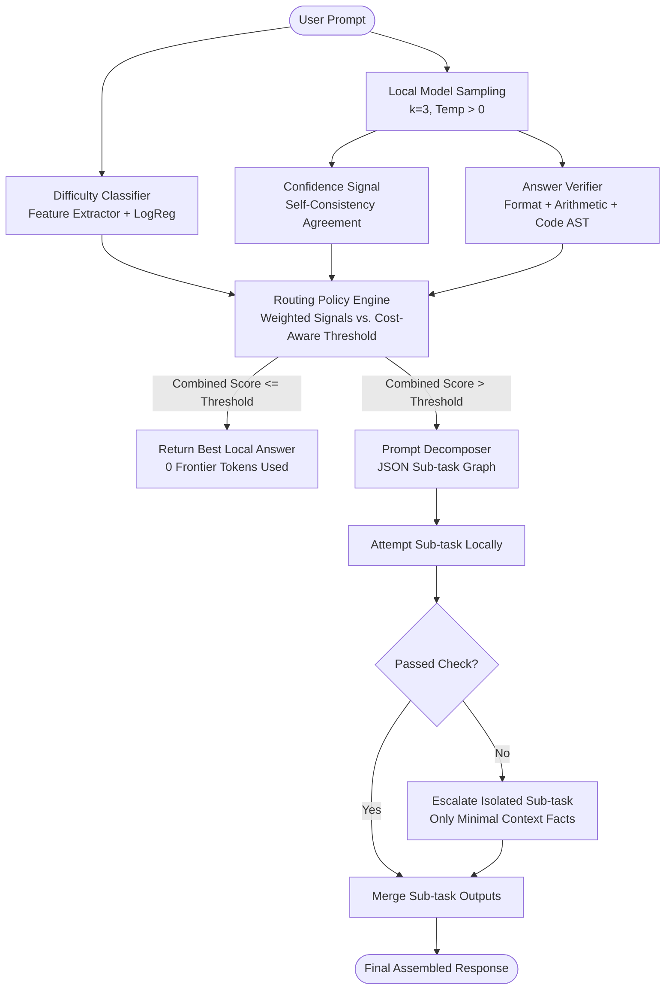

# Adaptive Local-First LLM Router

[](https://www.python.org/)
[](https://opensource.org/licenses/MIT)

An adaptive routing system that answers queries on small local LLMs by default and selectively escalates complex tasks—or isolated sub-tasks via prompt decomposition—to frontier models (Google Gemini). Minimizes token consumption and economic cost while retaining frontier-tier quality.

---

> [!WARNING]
> **Data Privacy Notice for Gemini Free-Tier:**
> In accordance with Google's terms of service, prompts sent through the **free-tier API** may be reviewed by human annotators and used to train or improve Google products. **Never route sensitive, proprietary, or personal data through the free tier.** Use only public benchmark datasets.

---

## Architecture Overview



---

## Hardware & Environment Requirements

- **Target Device:** MacBook Air M1 (or any Apple Silicon / Unix machine) with 8GB unified RAM.
- **Local Model Policy:** Quantized models only (`qwen2.5:1.5b-instruct` or `qwen2.5:3b-instruct`). Only one local model is loaded at any given time.
- **Local Runtime:** Ollama REST API (`http://localhost:11434`).
- **Memory Footprint:** Resident memory is continuously tracked via `psutil`.

---

## Installation & Setup

### 1. Prerequisites & Ollama

Install [Ollama](https://ollama.ai) and pull the default lightweight models:

```bash
# Install Ollama (macOS)
brew install ollama

# Start the Ollama background daemon
ollama serve

# In a separate terminal, pull the recommended small models
ollama pull qwen2.5:1.5b-instruct
ollama pull qwen2.5:3b-instruct
```

### 2. Gemini Frontier API Key

1. Visit [Google AI Studio](https://aistudio.google.com/) and create a free Gemini API key.
2. Export your key in your shell:

```bash
export GEMINI_API_KEY="your-gemini-api-key-here"
```

> **Note:** If `GEMINI_API_KEY` is not present, the router will automatically fall back to deterministic offline mock clients with a visible notice, allowing full end-to-end testing without external network access.

### 3. Project Dependencies

Using `uv` (recommended):

```bash
uv sync
```

Or using standard `pip`:

```bash
python3 -m pip install -e .
```

---

## CLI Usage

The router CLI exposes commands for dataset construction, difficulty classifier training, benchmarking, and interactive querying:

### 1. Build Benchmark Datasets
Constructs seeded splits (dev and test) across GSM8K, ARC-Challenge, MBPP, and synthetic Multi-Part tasks:
```bash
uv run router data build
```

### 2. Train Difficulty Classifier
Trains a logistic regression model on hand-crafted lexical, syntactic, and structural prompt features:
```bash
uv run router train-difficulty
```

### 3. Ask a Single Prompt (Interactive Test)
Test the routing decision on any arbitrary query:
```bash
uv run router ask "What is 15 * 8, and who developed the Python programming language?"
```

### 4. Evaluate a Specific System
Run a single system baseline on the test split:
```bash
uv run router run --system proposed --split test --max-requests 30
```

### 5. Full Benchmark Across All Systems
Evaluates all baselines, computes bootstrap 95% confidence intervals, plots Pareto curves, and generates reports:
```bash
uv run router eval --all
```

### 6. Regenerate Report from Logs
Recompute charts and summary tables from an existing results directory:
```bash
uv run router report results/eval_YYYYMMDD_HHMMSS
```

---

## Implemented Baselines & Ablations

| System Name | Routing Strategy | Description |
| :--- | :--- | :--- |
| `local_only` | Always Local | Zero frontier tokens used; serves as the cost floor. |
| `frontier_only` | Always Frontier | All prompts sent directly to Gemini; serves as the quality ceiling. |
| `rule_based` | Naive Heuristic | Escalates if prompt has code blocks, length > threshold, or triggers keywords. |
| `proposed` | Adaptive + Decomposition | Full router combining Difficulty, Confidence, and Verifier with minimal-context prompt decomposition. |
| `no_decomposition` | Router without Decomposition | Escalates full prompt on difficulty/uncertainty without splitting sub-tasks. |
| `difficulty_only` | Single Signal Ablation | Routing decision driven strictly by the logistic regression difficulty score. |
| `confidence_only` | Single Signal Ablation | Routing decision driven strictly by self-consistency answer agreement. |
| `verifier_only` | Single Signal Ablation | Routing decision driven strictly by arithmetic, code syntax, and format checks. |

---

## Benchmark Metrics & Accounting

- **Quality Score:**
  - GSM8K: Exact numerical match.
  - ARC-Challenge: Multiple choice exact letter match.
  - MBPP: Python execution in sandboxed subprocess against unit test assertions.
  - Multi-Part: Per-sub-question accuracy.
- **Equivalent Cost (USD):** Computed from Google's published list prices:
  - `gemini-3.1-pro-preview`: \$1.25 / 1M input tokens, \$10.00 / 1M output tokens, \$3.75 / 1M thinking tokens.
  - `gemini-3.8-flash`: \$0.10 / 1M input tokens, \$0.40 / 1M output tokens, \$0.25 / 1M thinking tokens.
- **Frontier Token Accounting:** Separate tracking for Input, Candidates Output, and Reasoning/Thinking tokens.
- **Latency & Memory:** Mean and 95th percentile wall-clock latency; peak resident memory (RSS MB) of the Ollama process sampled via `psutil`.

---

## Testing & Verification

Run the comprehensive unit and integration test suite:

```bash
make test
```

All 8 test modules run entirely offline with mock clients:
- `tests/test_signals.py`: Feature extraction, training, self-consistency agreement, arithmetic verification.
- `tests/test_router.py`: Cost-aware threshold scaling ($\lambda$) and signal fusion.
- `tests/test_decompose.py`: JSON schema parsing, sub-task dependency filtering, and context isolation.
- `tests/test_cache.py`: On-disk response caching and SHA-256 parameter hashing.
- `tests/test_rate_limiter.py`: Request rate limiters and session caps.
- `tests/test_metrics.py`: Bootstrap 95% confidence intervals and token savings formulas.
- `tests/test_pipeline.py`: Full end-to-end evaluation pipeline on 10-task fixtures with mock clients.

---

## Expected Runtime

- **Offline / Mock Mode:** Entire test suite runs in under **5 seconds**.
- **Local Ollama Inference (M1 8GB):** ~1.5s–3.5s per query using `qwen2.5:1.5b-instruct` (Metal GPU accelerated).
- **Gemini Free-Tier Evaluation:** ~10 requests per minute due to client-side rate limiting (~12 minutes for a full 120-task benchmark).

---

## Project Structure

```
llm-router/
├── config.yaml               # Pydantic-validated project configuration
├── pyproject.toml            # Dependencies and CLI scripts
├── Makefile                  # Build, test, lint, and eval automation
├── docs/
│   └── DECISIONS.md          # Architectural decisions & default rationale
├── src/
│   ├── eval/                 # Evaluation dataset, scoring, and Pareto plots
│   │   ├── data_build.py
│   │   ├── metrics.py
│   │   ├── plots.py
│   │   ├── report.py
│   │   └── scoring.py
│   └── router/               # Core routing library
│       ├── baselines/        # Baseline and ablation systems
│       │   └── systems.py
│       ├── clients/          # Ollama, Gemini, and Mock client adapters
│       │   ├── base.py
│       │   ├── cache.py
│       │   ├── frontier.py
│       │   ├── local.py
│       │   └── mock.py
│       ├── signals/          # Difficulty, Confidence, and Verifier signals
│       │   ├── confidence.py
│       │   ├── difficulty.py
│       │   └── verifier.py
│       ├── cli/              # Typer CLI application
│       │   └── main.py
│       ├── config.py         # Pydantic v2 configuration models
│       ├── decompose.py      # Prompt decomposition & context isolation
│       ├── models.py         # Pipeline data models & schemas
│       ├── pipeline.py       # Evaluation orchestration engine
│       └── router.py         # Multi-signal decision engine
└── tests/                    # 100% offline test suite
```
